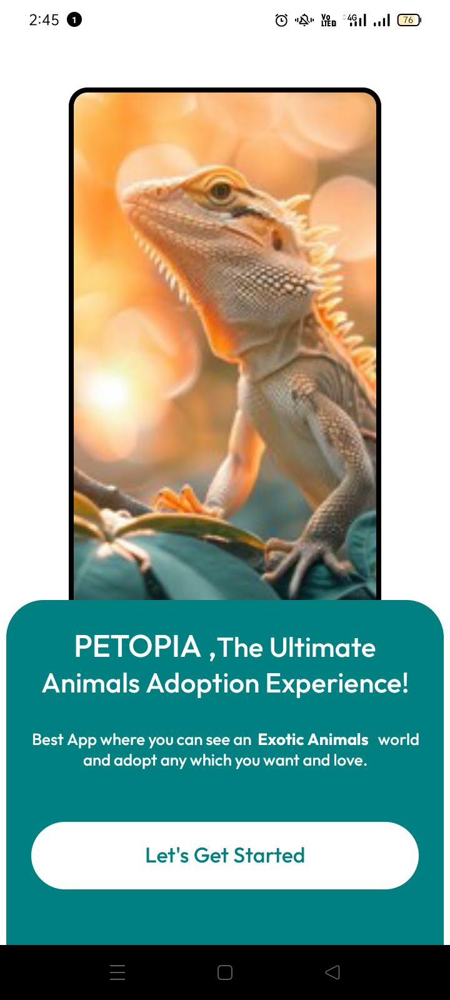
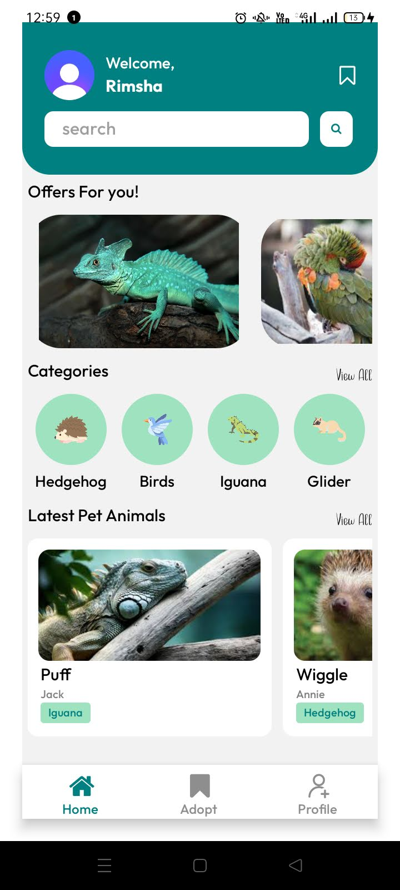
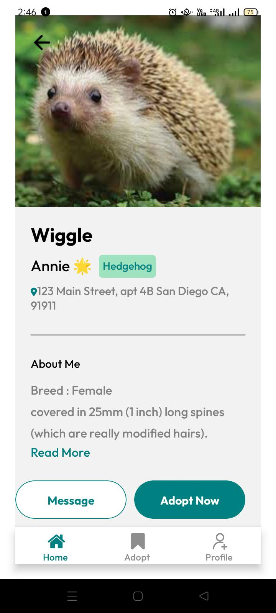
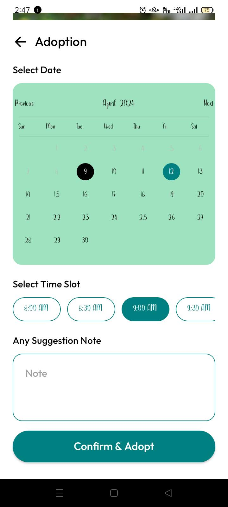
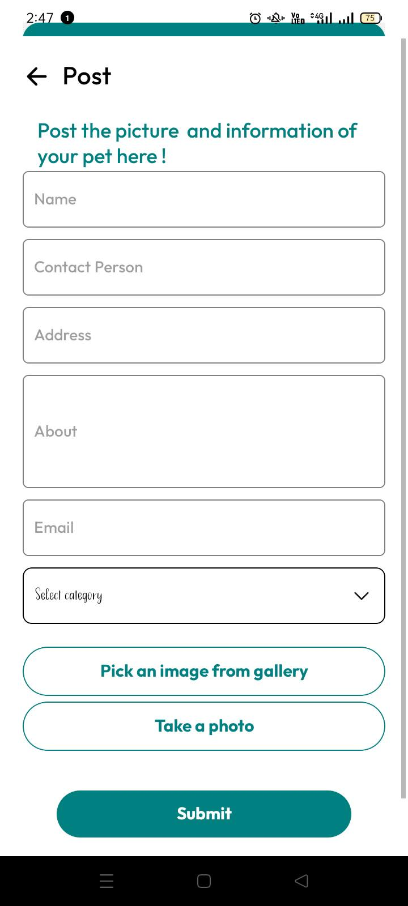

# PETOPIA - The Ultimate Animals Adoption Experience!

Best App where you can see an Exotic Animals world and adopt any which you want and love.

Built with React Native, Expo Go, Clerk Authentication & Firebase.

## Features

- Google Sign-In with Clerk Auth
- Home Feed with Offers, Categories & Latest Pets
- Categories: Hedgehog, Birds, Iguana, Sugar Glider
- Pet Detail Page with Owner Info, Breed, Color, About
- Adoption Booking with Date Calendar + Time Slot Selection
- My Booking List with Booked / Canceled Status
- Direct Email to Pet Owner via Message Button
- Profile with Home, My Booking, Post Pet Info, Logout

## Screenshots

### 1. Splash Screen

### 2. Home Page

### 3. Pet Detail Page

### 4. Adoption Booking

### 5. My Bookings

## Tech Stack
- React Native + Expo
- Clerk (Google Authentication)
- Firebase / Firestore
- React Navigation

## Note
This project was originally developed as a University Final Year Project. Source code was lost due to laptop failure, but UI flow and functionality are preserved via original app recordings.
